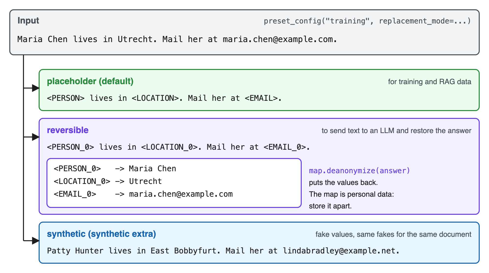

# SqueakyCleanText

[](https://pypi.org/project/squeakycleantext/)
[](https://github.com/rhnfzl/SqueakyCleanText/actions/workflows/python-package.yml)
[](https://pypi.org/project/squeakycleantext/)
[](https://github.com/rhnfzl/SqueakyCleanText/blob/main/LICENSE)

**Clean, privacy-safe text datasets for LLM training, fine-tuning and RAG, in 75 languages.**

SqueakyCleanText (SCT) is a text processing pipeline for datasets. A JSONL file, a Hugging Face dataset or a DataTrove job goes in. Cleaned text comes out, plus `sct_*` columns and a data card that describe each record without storing personal data. It runs on CPU or GPU.

```text
in:   I’m Anna Berg & my mail is anna@example.se. Order 4711 ships on 2024-05-01.
out:  I'm <PERSON> & my mail is <EMAIL>. Order 4711 ships on 2024-05-01.
      sct_language=ENGLISH  sct_pii_count=2  sct_pii_types=['EMAIL', 'PERSON']

in:   Bel +31 20 123 4567 voor Jan de Vries.
out:  Bel <PHONE> voor <PERSON>.
      sct_language=DUTCH  sct_pii_count=2  sct_pii_types=['PERSON', 'PHONE']
```

Documentation: <https://rhnfzl.github.io/SqueakyCleanText/>

## What it does

One call runs these stages. Each one is a config field with a safe default, so you can switch it off.

1. **Detect the language.** One of 75 languages, with a confidence score. Pin it or limit it when you know.
2. **Repair the text.** Fixes mojibake and HTML entities (ftfy), folds styled characters, tidies whitespace, and can replace HTML tags, numbers and dates with tags.
3. **Remove personal data.** Regex rules (emails, phones, URLs, IPs, IBAN and card numbers) and an ensemble of multilingual NER models (names, places, organisations). Found values become:
   - tags such as `<PERSON>` (default),
   - realistic fake values (`synthetic`), or
   - reversible placeholders `<PERSON_0>` plus a map you store apart.

   SCT ships no word lists; pass your own terms to always mask (`custom_deny_terms`), never mask (`custom_allow_terms`), or your own labelled regex (`custom_patterns`).
4. **Score and document.** Every result has value-free `signals`. Turn them into `sct_*` columns (language, PII share, warnings; optional quality score and MinHash for near-duplicate removal) and a data card with `sct-report` ([docs/SCORE.md](https://github.com/rhnfzl/SqueakyCleanText/blob/main/docs/SCORE.md)).
5. **Scale.** `process_batch` runs documents in threads and batches the NER calls, on CPU (ONNX Runtime, no PyTorch needed) or an NVIDIA GPU. Adapters for Hugging Face `datasets`, DataTrove, LangChain, Haystack and MCP.


SCT finds most personal data, not all of it. Check its output before you publish sensitive data.

<!-- --8<-- [start:quickstart] -->
## Install

```sh
pip install squeakycleantext
```

Python 3.12 or newer. Add extras for what you use, for example `pip install "squeakycleantext[datasets,gpu]"`:

| Extra | Why you need it |
|---|---|
| `datasets`, `datatrove` | Clean Hugging Face datasets or DataTrove pipelines |
| `langchain`, `haystack` | Clean documents in RAG pipelines |
| `gpu` | Run NER on an NVIDIA GPU |
| `synthetic` | Replace personal data with fake values |
| `score` | MinHash signatures for near-duplicate removal |
| `gliner` | Your own entity labels, and `ner_mode="pii"` (58 PII labels) |
| `mcp` | Run SCT as an MCP server for AI assistants |

All extras: [docs/INSTALL.md](https://github.com/rhnfzl/SqueakyCleanText/blob/main/docs/INSTALL.md).

## Quickstart

For training and RAG data, use the `training` preset. It repairs the text and replaces personal data. Numbers, dates, HTML, case, line breaks and code stay as written.

```python
from sct import TextCleaner, preset_config
from sct.score import score_record

cleaner = TextCleaner(cfg=preset_config("training"))
for r in cleaner.process_batch([
    "I’m Anna Berg &amp; my mail is anna@example.se. Order 4711 ships on 2024-05-01.",
    "Bel +31 20 123 4567 voor Jan de Vries.",
]):
    row = score_record(r)
    print(r.lm_text)
    print(row["sct_language"], row["sct_pii_count"], row["sct_pii_types"])
# -> I'm <PERSON> & my mail is <EMAIL>. Order 4711 ships on 2024-05-01.
# -> ENGLISH 2 ['EMAIL', 'PERSON']
# -> Bel <PHONE> voor <PERSON>.
# -> DUTCH 2 ['PERSON', 'PHONE']
```

The first run downloads the NER models.

**A whole Hugging Face dataset** (`datasets` extra). `clean_dataset` wraps `Dataset.map`: `batch_size`, `num_proc` and other `map` arguments pass through. `output="new_column"` keeps the original text next to the cleaned `text_clean`, and `score=True` adds the `sct_*` columns.

```python
from datasets import Dataset
from sct.integrations.hf import clean_dataset

if __name__ == "__main__":
    ds = Dataset.from_dict({"text": ["Mail jan@example.nl", "Call Maria Chen on +44 20 7946 0958."]})
    ds = clean_dataset(ds, columns=["text"], output="new_column", score=True, num_proc=2)
    print(ds[1]["text_clean"], ds[1]["sct_pii_types"])
    # -> Call <PERSON> on <PHONE>. ['PERSON', 'PHONE']
```

**Full cleanup for classic ML.** The default config (`TextCleaner()`) also replaces ID-shaped numbers, dates and HTML, and `stat_text` gives a lower-cased version without stopwords and punctuation:

```python
from sct import TextCleaner

result = TextCleaner().process("I’m Anna Berg &amp; my mail is anna@example.se. Order 4711 ships on 2024-05-01.")
print(result.lm_text)    # -> I'm <PERSON> & my mail is <EMAIL>. Order <NUMBER> ships on <DATE>.
print(result.stat_text)  # -> person mail email number ships date
```
<!-- --8<-- [end:quickstart] -->

## Use it in your data pipeline

**DataTrove** (`datatrove` extra). Put SCT after your language and quality filters, so the NER step only sees documents you keep:

```python
from datatrove.executor import LocalPipelineExecutor
from datatrove.pipeline.readers import JsonlReader
from datatrove.pipeline.writers import JsonlWriter
from sct.integrations.datatrove import SCTCleaner

if __name__ == "__main__":
    LocalPipelineExecutor(
        pipeline=[JsonlReader("raw/"), SCTCleaner(), JsonlWriter("clean/")],
        tasks=4,
        workers=2,
    ).run()
```

**Everything else:**

| Where | Usage | Docs |
|---|---|---|
| LangChain | `SCTDocumentTransformer().transform_documents(docs)` | [INTEGRATIONS](https://github.com/rhnfzl/SqueakyCleanText/blob/main/docs/INTEGRATIONS.md) |
| Haystack | `pipe.add_component("sct", SCTDocumentCleaner())` | [INTEGRATIONS](https://github.com/rhnfzl/SqueakyCleanText/blob/main/docs/INTEGRATIONS.md) |
| Ray, Spark, Polars, DuckDB, dlt, Daft | `clean_columns(handle, batch)` | [RECIPES](https://github.com/rhnfzl/SqueakyCleanText/blob/main/docs/RECIPES.md) |
| JSON, DataFrames, RAG chunks, streams | `process_json(cleaner, value)`, `WindowedStreamingRedactor(cleaner)` | [ADAPTERS](https://github.com/rhnfzl/SqueakyCleanText/blob/main/docs/ADAPTERS.md) |
| Command line | `printf 'Email maria@example.com' \| sct-clean --no-ner` | [ADAPTERS](https://github.com/rhnfzl/SqueakyCleanText/blob/main/docs/ADAPTERS.md) |
| Data card for a file | `sct-report data.jsonl --text-column text --out report.json --card card.md` | [SCORE](https://github.com/rhnfzl/SqueakyCleanText/blob/main/docs/SCORE.md) |
| AI assistants | `sct-mcp` (MCP server, `mcp` extra) | [MCP](https://github.com/rhnfzl/SqueakyCleanText/blob/main/docs/MCP.md) |

The framework adapters use the `training` preset unless you pass a config, so their output keeps numbers, dates, HTML and case. They build one cleaner per worker process and reject reversible mode. Plan for 5 to 7 GB of RAM per worker with the default NER ensemble.

## How it works


<details>
<summary>The diagram as text</summary>

- Entry points: any of them (`process()`, `process_batch()`, `sct-clean`, `sct-mcp`, the adapters and the streaming redactors) runs the same pipeline.
- 1 Detect language: Lingua, 75 languages, on the raw input. Pin it or limit it with `language=`. Low confidence adds a warning. The language picks the NER models and the Faker locale.
- 2 Fix the text: Unicode repair (ftfy), styled-character folding, HTML entities and tags. ASCII transliteration and emoji removal are off by default.
- 3 Regex PII and cleanup, in this order: URLs, emails, IPs, dates, fuzzy dates (off), IBANs and cards (checksums), ID codes (off), phones, years, numbers, currency symbols, then isolated letters, isolated symbols (with short bracket and brace content), and whitespace. Counted in `regex_counts`.
- 4 NER: ONNX models per language, a vote that keeps a span when its best model score passes the threshold, chunk windows for long text, propagation of masked names to their other copies, and span edges snapped to word edges. GLiNER and `ner_mode="pii"` are opt in.
- 5 Replacement mode: `<PERSON>` tags by default; synthetic fakes or reversible `<PERSON_0>` with a map (or a `TokenStore` reference) are opt in. The map holds personal data. Placeholder tags are written in steps 3 and 4; synthetic and reversible swap the values in after NER.
- 6 Output: `lm_text`, `stat_text` (lower case, no stopwords or punctuation), `language`, value-free `signals`, and `metadata` with `regex_counts`.
- Across all stages (not drawn): `process_batch` runs documents in threads and batches NER across documents (`ner_batch_size`); NER runs on CPU, CUDA or, for torch and GLiNER, the Apple GPU (`ner_device='mps'`, opt-in); the `training` preset keeps numbers, dates and HTML.

</details>

Every step is a `TextCleanerConfig` field ([docs/CONFIG.md](https://github.com/rhnfzl/SqueakyCleanText/blob/main/docs/CONFIG.md)). The diagrams are built by [scripts/diagrams/](https://github.com/rhnfzl/SqueakyCleanText/tree/main/scripts/diagrams); open the `.excalidraw` files in [resources/](https://github.com/rhnfzl/SqueakyCleanText/tree/main/resources) to view them in Excalidraw.

<!-- --8<-- [start:results] -->
## What you get back

`process` and `process_batch` return a `ProcessResult`:

- `lm_text`: the cleaned text, sentences intact, for LLMs, RAG and training.
- `stat_text`: lower-cased, without stopwords and punctuation, for classic ML models.
- `language`: the detected language.
- `signals`: a value-free view with the same keys for every input: language and confidence, `pii_count`, `pii_share`, `pii_types`, `sensitive`, warnings and the NER models that ran. Safe to log or store next to the text.
- `metadata`: the same counts, plus raw values only when you ask for them (the reversible map, or `findings` with `include_entities=True`). Keep those out of logs.

`score_record` turns a result into flat `sct_*` columns for filtering and data cards. `ScoreConfig` adds an optional quality score and a MinHash signature. Fields: [docs/API.md](https://github.com/rhnfzl/SqueakyCleanText/blob/main/docs/API.md), columns: [docs/SCORE.md](https://github.com/rhnfzl/SqueakyCleanText/blob/main/docs/SCORE.md).

| PII mode | Output | Use it for |
|---|---|---|
| `placeholder` (default) | `<PERSON> lives in <LOCATION>.` | Training and RAG data |
| `synthetic` (`synthetic` extra) | Fake values, for example `Patty Hunter lives in East Bobbyfurt.` (the same document always gets the same fakes) | Data that must still read naturally |
| `reversible` | `<PERSON_0> lives in <LOCATION_0>.` plus a map | Sending text to an LLM and restoring the answer |



Modes, privacy policies and more PII types (`ner_mode="pii"`): [docs/REPLACEMENT_MODES.md](https://github.com/rhnfzl/SqueakyCleanText/blob/main/docs/REPLACEMENT_MODES.md), [docs/PRIVACY.md](https://github.com/rhnfzl/SqueakyCleanText/blob/main/docs/PRIVACY.md), [docs/NER_BACKENDS.md](https://github.com/rhnfzl/SqueakyCleanText/blob/main/docs/NER_BACKENDS.md).
<!-- --8<-- [end:results] -->

## Speed and hardware

Default config (full multilingual NER ensemble), release benchmark documents (up to about 900 characters), SCT 0.8.0, AMD Threadripper PRO 7985WX and RTX 4090, median of 3 runs. 0.8.1 runs at the same speed.

| Workload | Hardware | Docs/s |
|---|---|---|
| `process`, one document at a time | 16 CPU cores | 5.0 |
| `process_batch`, short documents, 16 workers | 16 CPU cores | 15.5 |
| `process_batch`, short documents, 16 workers | 64 CPU cores | 29.2 |
| `process_batch`, short documents, full ensemble | 3x RTX 4090 (models split across GPUs) | 130 |
| `process_batch`, short documents, English only (2 models) | 1x RTX 4090 | 646 |

The full ensemble needs about 12 to 16 GB of free memory on one GPU; English only needs 3 to 5 GB. As a rough estimate from this table, 1 million short documents take about 26 minutes English-only on one RTX 4090, about 2 hours with the full ensemble on 3 GPUs, and about 10 hours on 64 CPU cores.

NER is the slow stage. Turn it off (`check_ner_process=False`) for regex-only cleaning, or limit `language=` to load fewer models. Hardware advice and GPU setup: [docs/PERFORMANCE.md](https://github.com/rhnfzl/SqueakyCleanText/blob/main/docs/PERFORMANCE.md).

## Quality

Measured on open datasets with [benchmarks/](https://github.com/rhnfzl/SqueakyCleanText/tree/main/benchmarks).

- **Cleaning** (FineWeb-2 with injected noise, default config): 100% of HTML, 99.6% of mojibake and 100% of URLs removed.
- **Language detection** (WiLI): 95.1% accuracy over 7,200 documents.
- **PII** (12 open PII datasets, about 40 languages): the 0.8.1 release branch leaked fewer values than 0.8.0 on every dataset, for example 18.1% to 8.2% on REDACT ([comparison](https://github.com/rhnfzl/SqueakyCleanText/blob/main/benchmarks/results/comparison-0.8.0-unreleased.md), pre-release commit `2078e8c4`).
- **Multilingual PII eval** (220 records, 11 languages): 0.93 recall, 0.95 precision ([docs/MULTILINGUAL_EVAL.md](https://github.com/rhnfzl/SqueakyCleanText/blob/main/docs/MULTILINGUAL_EVAL.md)).

Test your own data or model with the evaluation harness ([docs/EVALUATION.md](https://github.com/rhnfzl/SqueakyCleanText/blob/main/docs/EVALUATION.md)).

## Languages

Language detection covers 75 languages. Full NER models cover English, Dutch, German and Spanish. The other languages use the multilingual WikiNEural model with the English model, or a model you bring with `ner_models`. Full list: [docs/LANGUAGES.md](https://github.com/rhnfzl/SqueakyCleanText/blob/main/docs/LANGUAGES.md).

<!-- --8<-- [start:limits] -->
## Limits and design principles

- **Safe defaults, every choice configurable.** Each behaviour is a config field; nothing is forced.
- **No guarantee that all PII is found.** Models miss entities, mostly organisations and non-Latin scripts. Review output before you publish it.
- **Free text, not tables.** For tables with known PII columns, drop or hash those columns first.
- **Reversible maps are personal data.** Anyone with the map can restore the values. Store maps apart from the cleaned data, with access control.
- **Synthetic data is not anonymisation.** Fake values keep the data useful; they do not make it anonymous in a legal sense.
- **Offsets are post-regex.** Finding offsets point into the text after the regex step, not into the raw input.
<!-- --8<-- [end:limits] -->

Detailed known limits of 0.8.2: [docs/limits.md](https://github.com/rhnfzl/SqueakyCleanText/blob/main/docs/limits.md).

## Documentation

| Topic | Where |
|---|---|
| Install, extras, speed and hardware | [docs/INSTALL.md](https://github.com/rhnfzl/SqueakyCleanText/blob/main/docs/INSTALL.md), [docs/PERFORMANCE.md](https://github.com/rhnfzl/SqueakyCleanText/blob/main/docs/PERFORMANCE.md) |
| Every config field, presets, language options | [docs/CONFIG.md](https://github.com/rhnfzl/SqueakyCleanText/blob/main/docs/CONFIG.md) |
| `TextCleaner`, `ProcessResult`, `signals` | [docs/API.md](https://github.com/rhnfzl/SqueakyCleanText/blob/main/docs/API.md) |
| Data pipelines, other engines, MCP server | [docs/INTEGRATIONS.md](https://github.com/rhnfzl/SqueakyCleanText/blob/main/docs/INTEGRATIONS.md), [docs/RECIPES.md](https://github.com/rhnfzl/SqueakyCleanText/blob/main/docs/RECIPES.md), [docs/MCP.md](https://github.com/rhnfzl/SqueakyCleanText/blob/main/docs/MCP.md) |
| JSON, DataFrame, RAG, CLI, streaming, OCR | [docs/ADAPTERS.md](https://github.com/rhnfzl/SqueakyCleanText/blob/main/docs/ADAPTERS.md) |
| Score columns, quality, MinHash, data cards, `sct-report` | [docs/SCORE.md](https://github.com/rhnfzl/SqueakyCleanText/blob/main/docs/SCORE.md) |
| NER backends, GLiNER, PII mode | [docs/NER_BACKENDS.md](https://github.com/rhnfzl/SqueakyCleanText/blob/main/docs/NER_BACKENDS.md) |
| Replacement modes, privacy policies, `TokenStore` | [docs/REPLACEMENT_MODES.md](https://github.com/rhnfzl/SqueakyCleanText/blob/main/docs/REPLACEMENT_MODES.md), [docs/PRIVACY.md](https://github.com/rhnfzl/SqueakyCleanText/blob/main/docs/PRIVACY.md) |
| Evaluation | [docs/EVALUATION.md](https://github.com/rhnfzl/SqueakyCleanText/blob/main/docs/EVALUATION.md), [docs/MULTILINGUAL_EVAL.md](https://github.com/rhnfzl/SqueakyCleanText/blob/main/docs/MULTILINGUAL_EVAL.md) |
| Languages and adding a language | [docs/LANGUAGES.md](https://github.com/rhnfzl/SqueakyCleanText/blob/main/docs/LANGUAGES.md), [docs/ADDING_LANGUAGES.md](https://github.com/rhnfzl/SqueakyCleanText/blob/main/docs/ADDING_LANGUAGES.md) |
| The whole API in one file, for AI coding assistants | [llms.txt](https://github.com/rhnfzl/SqueakyCleanText/blob/main/llms.txt) |
| Release notes | [CHANGELOG.md](https://github.com/rhnfzl/SqueakyCleanText/blob/main/CHANGELOG.md) |

**New in 0.8.1:** fewer leaks at the same speed, `<IBAN>` and `<CARD>` tags, and JSON and longer bracketed text survive cleanup. Some defaults changed; each has a setting to switch it back ([CHANGELOG.md](https://github.com/rhnfzl/SqueakyCleanText/blob/main/CHANGELOG.md)).

## Contributing

Issues and pull requests are welcome. Read [AGENTS.md](https://github.com/rhnfzl/SqueakyCleanText/blob/main/AGENTS.md) first: model mistakes are fixed with model-driven rules, never with word lists, and every behaviour stays configurable.

## Citation

```bibtex
@software{fazal_squeakycleantext,
  author = {Fazal, Rehan},
  title = {SqueakyCleanText},
  url = {https://github.com/rhnfzl/SqueakyCleanText},
  version = {0.8.1},
  year = {2026}
}
```

## License and acknowledgements

MIT. See [LICENSE](https://github.com/rhnfzl/SqueakyCleanText/blob/main/LICENSE). The package took inspiration from [clean-text](https://github.com/jfilter/clean-text). It builds on [ftfy](https://github.com/rspeer/python-ftfy), [Lingua](https://github.com/pemistahl/lingua-py), [ONNX Runtime](https://onnxruntime.ai/) and the NER models listed in [docs/NER_BACKENDS.md](https://github.com/rhnfzl/SqueakyCleanText/blob/main/docs/NER_BACKENDS.md).
