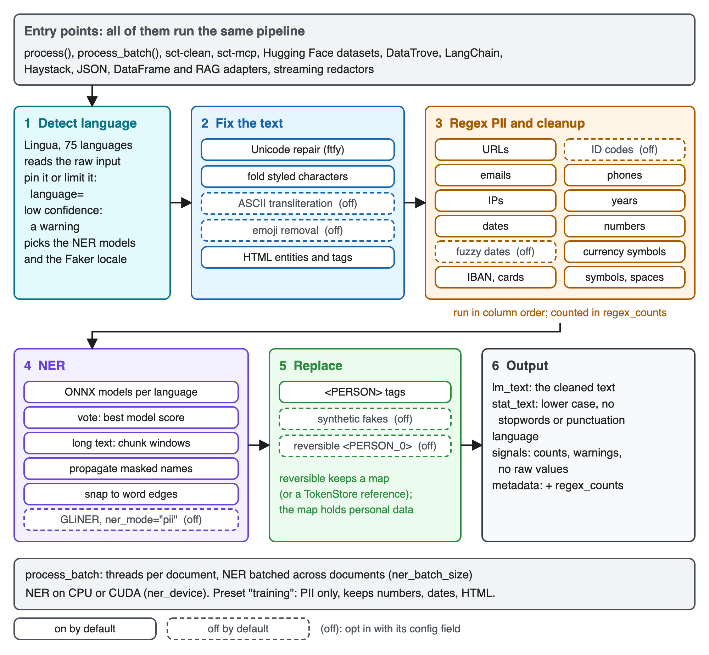
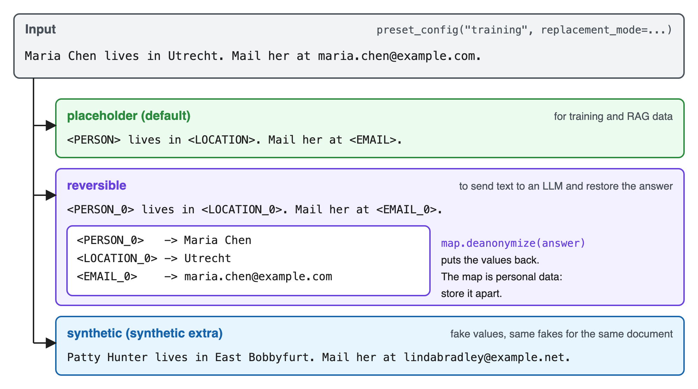

# SqueakyCleanText

[](https://pypi.org/project/squeakycleantext/)
[](https://github.com/rhnfzl/SqueakyCleanText/actions/workflows/python-package.yml)
[](https://pypi.org/project/squeakycleantext/)
[](https://github.com/rhnfzl/SqueakyCleanText/blob/main/LICENSE)

**Clean text and mask personal details before you index it for search, train a model, or share a dataset.**

SqueakyCleanText (SCT) repairs text, masks the personal data it finds, and returns counts and warnings you can review.
Use it on a string or batch, in an existing data pipeline, or to turn extracted document text into cleaned chunks.
Choose the stages, providers, and privacy rules your workflow needs.

```text
in:   I’m Anna Berg & my mail is anna@example.se. Order 4711 ships on 2024-05-01.
out:  I'm <PERSON> & my mail is <EMAIL>. Order 4711 ships on 2024-05-01.
      sct_language=ENGLISH  sct_pii_count=2  sct_pii_types=['EMAIL', 'PERSON']

in:   Bel +31 20 123 4567 voor Jan de Vries.
out:  Bel <PHONE> voor <PERSON>.
      sct_language=DUTCH  sct_pii_count=2  sct_pii_types=['PERSON', 'PHONE']
```

Review the output before sharing sensitive data. SCT can miss personal details.

## What you can do

| If you need to… | Use SCT to… |
|---|---|
| Prepare text for training or retrieval | Repair broken Unicode and decode HTML entities. The `training` preset preserves formatting and ordinary dates and numbers. |
| Protect personal data before sharing | Combine format rules and entity models, then use placeholders, realistic replacements, or reversible tokens. Apply your own handling rules and field schemas. |
| Index PDFs or long documents | Extract PDF text with page and table structure, clean it, and split the cleaned text into bounded chunks. Choose detector windows separately from the chunks you export. |
| Curate and audit a corpus | Score records, review near-duplicate decisions, and generate a data card. Use explicit selection rules when you want to remove records. |
| Fit SCT into an existing workflow | Use Python, JSONL and the CLI, structured records, Hugging Face datasets, DataTrove, LangChain, Haystack, or MCP. Batch model inference on CPU or supported GPUs. |

SCT detects 75 languages. Name, place, and organisation coverage depends on the model and language.
See [language coverage](https://github.com/rhnfzl/SqueakyCleanText/blob/main/docs/LANGUAGES.md) and the [documentation site](https://rhnfzl.github.io/SqueakyCleanText/).

## Install

```sh
pip install squeakycleantext
```

Python 3.12 or newer. Add extras for what you use, for example `pip install "squeakycleantext[datasets,gpu]"`:

| Extra | Why you need it |
|---|---|
| `datasets`, `datatrove` | Clean Hugging Face datasets or DataTrove pipelines |
| `langchain`, `haystack` | Clean documents in RAG pipelines |
| `gpu` | Run NER on an NVIDIA GPU |
| `synthetic` | Replace personal data with fake values |
| `score`, `corpus` | Corpus scoring and near-duplicate selection, or native DataTrove curation with checkpoints |
| `documents`, `ocr` | Extract PDF text with Docling, or cover image regions with an OCR provider |
| `chunking` | Add Semchunk and Chonkie providers to built-in chunking |
| `token-store`, `secrets` | Store encrypted reversible maps, or detect supported credential formats |
| `gliner` | Your own entity labels, and `ner_mode="pii"` (58 PII labels) |
| `mcp` | Run SCT as an MCP server for AI assistants |

All extras: [docs/INSTALL.md](https://github.com/rhnfzl/SqueakyCleanText/blob/main/docs/INSTALL.md).

## Quickstart

<!-- --8<-- [start:quickstart] -->
Try format-based masking from the command line without loading a name model.

```sh
printf 'Email maria@example.com' | sct-clean --no-ner
# Email <EMAIL>
```

For training and retrieval data, use the `training` preset. It repairs text and masks detected personal data.
It preserves numbers, dates, HTML tags, case, and line breaks by default, subject to configured repairs and PII replacement.

```python
from sct import TextCleaner, preset_config
from sct.score import score_record

cleaner = TextCleaner(cfg=preset_config("training"))
for r in cleaner.process_batch([
    "I’m Anna Berg &amp; my mail is anna@example.se. Order 4711 ships on 2024-05-01.",
    "Bel +31 20 123 4567 voor Jan de Vries.",
]):
    row = score_record(r)
    print(r.lm_text)
    print(row["sct_language"], row["sct_pii_count"], row["sct_pii_types"])
# -> I'm <PERSON> & my mail is <EMAIL>. Order 4711 ships on 2024-05-01.
# -> ENGLISH 2 ['EMAIL', 'PERSON']
# -> Bel <PHONE> voor <PERSON>.
# -> DUTCH 2 ['PERSON', 'PHONE']
```

The first run downloads the NER models.

**A whole Hugging Face dataset** (`datasets` extra). `clean_dataset` wraps `Dataset.map`: `batch_size`, `num_proc` and other `map` arguments pass through. `output="new_column"` keeps the original text next to the cleaned `text_clean`, and `score=True` adds the `sct_*` columns.

```python
from datasets import Dataset
from sct.integrations.hf import clean_dataset

if __name__ == "__main__":
    ds = Dataset.from_dict({"text": ["Mail jan@example.nl", "Call Maria Chen on +44 20 7946 0958."]})
    ds = clean_dataset(ds, columns=["text"], output="new_column", score=True)
    print(ds[1]["text_clean"], ds[1]["sct_pii_types"])
    # -> Call <PERSON> on <PHONE>. ['PERSON', 'PHONE']
```

**Full cleanup for classic ML.** The default config (`TextCleaner()`) also replaces ID-shaped numbers, dates and HTML, and `stat_text` gives a lower-cased version without stopwords and punctuation:

```python
from sct import TextCleaner

result = TextCleaner().process("I’m Anna Berg &amp; my mail is anna@example.se. Order 4711 ships on 2024-05-01.")
print(result.lm_text)    # -> I'm <PERSON> & my mail is <EMAIL>. Order <NUMBER> ships on <DATE>.
print(result.stat_text)  # -> person mail email number ships date
```
<!-- --8<-- [end:quickstart] -->

## Use SCT in your pipeline

**DataTrove.** Install the pipeline adapter and the dependency for its JSONL reader and writer.

```sh
pip install "squeakycleantext[datatrove]" orjson
```

Put SCT after language and quality filters when you only want to clean the records you plan to keep.

```python
from datatrove.executor import LocalPipelineExecutor
from datatrove.pipeline.readers import JsonlReader
from datatrove.pipeline.writers import JsonlWriter
from sct.integrations.datatrove import SCTCleaner

if __name__ == "__main__":
    LocalPipelineExecutor(
        pipeline=[JsonlReader("raw/"), SCTCleaner(), JsonlWriter("clean/")],
        tasks=1,
        workers=1,
    ).run()
```

Choose an entry point based on the data you already have.

| Where | Usage | Docs |
|---|---|---|
| PDF text and tables | `extract_document`, `clean_document`, and the optional `DocumentExtractionRouter` | [DOCUMENTS](https://github.com/rhnfzl/SqueakyCleanText/blob/main/docs/DOCUMENTS.md) |
| Clean and chunk a document | `chunk_document(cleaner, text, max_size=1024)` | [CHUNKING](https://github.com/rhnfzl/SqueakyCleanText/blob/main/docs/CHUNKING.md) |
| LangChain | `SCTDocumentTransformer().transform_documents(docs)` | [INTEGRATIONS](https://github.com/rhnfzl/SqueakyCleanText/blob/main/docs/INTEGRATIONS.md) |
| Haystack | `pipe.add_component("sct", SCTDocumentCleaner())` | [INTEGRATIONS](https://github.com/rhnfzl/SqueakyCleanText/blob/main/docs/INTEGRATIONS.md) |
| Ray, Spark, Polars, DuckDB, dlt, Daft | `clean_columns(handle, batch)` | [RECIPES](https://github.com/rhnfzl/SqueakyCleanText/blob/main/docs/RECIPES.md) |
| JSON, DataFrames, existing chunks, streams, images | JSON and table adapters, `process_rag_chunks`, streaming redactors, and `redact_image` | [ADAPTERS](https://github.com/rhnfzl/SqueakyCleanText/blob/main/docs/ADAPTERS.md) |
| Command line | `printf 'Email maria@example.com' \| sct-clean --no-ner` | [ADAPTERS](https://github.com/rhnfzl/SqueakyCleanText/blob/main/docs/ADAPTERS.md) |
| Data card for a file | `sct-report data.jsonl --text-column text --out report.json --card card.md` | [SCORE](https://github.com/rhnfzl/SqueakyCleanText/blob/main/docs/SCORE.md) |
| AI assistants | `sct-mcp` (MCP server, `mcp` extra) | [MCP](https://github.com/rhnfzl/SqueakyCleanText/blob/main/docs/MCP.md) |

The framework adapters use the `training` preset unless you pass a config. They build one cleaner per worker process.
Check [worker memory and adapter limits](https://github.com/rhnfzl/SqueakyCleanText/blob/main/docs/INTEGRATIONS.md#workers-and-memory) before raising concurrency.
Use direct text processing when you need a reversible map.

### Clean a document and produce chunks

Use `chunk_document()` to clean the full document before you split it for search, training, or export.

```python
from sct import TextCleaner, TextCleanerConfig, chunk_document

cleaner = TextCleaner(TextCleanerConfig(check_ner_process=False))
result = chunk_document(cleaner, "Contact alice@example.com for details.", max_size=24)
texts = [chunk.text for chunk in result.chunks]
assert "alice@example.com" not in "".join(texts)
```

SCT can use Markdown headings or cleaned document elements as boundaries. Install
`SqueakyCleanText[chunking]` for Semchunk and Chonkie, or register your own splitter.
In unified PII processing, you can also choose a chunker for each compatible detector.
See [chunking providers and routing](https://github.com/rhnfzl/SqueakyCleanText/blob/main/docs/CHUNKING.md).

## How the stages fit together

- **Prepare the input.** Pass text directly, use a record adapter, or extract a document into text elements with available page and table information.
- **Detect and protect.** Configure normalization, language detection, format rules and models through `TextCleanerConfig`. Use the unified mode to apply one privacy policy across detectors and track source ranges.
- **Use the result.** Return cleaned text, split it into output chunks, or score and select records for a corpus. Output chunks and detector windows serve separate stages.

The legacy pipeline remains the default. See [configuration](https://github.com/rhnfzl/SqueakyCleanText/blob/main/docs/CONFIG.md) for presets, batch settings and migration to unified processing.

<details>
<summary>Legacy text-cleaning diagram</summary>



</details>

<!-- --8<-- [start:results] -->
## What you get back

`process` and `process_batch` return a `ProcessResult`:

- `lm_text`: cleaned text for LLMs, retrieval, and training.
- `stat_text`: lower-cased, without stopwords and punctuation, for classic ML models.
- `language`: the detected language.
- `signals`: a value-free view with the same keys for every input: language and confidence, `pii_count`, `pii_share`, `pii_types`, `sensitive` (`pii_count > 0`), warnings and the NER models that ran. Use these fields for quality checks without logging matched values.
- `metadata`: the same counts, plus raw values only when you ask for them (the reversible map, or `findings` with `include_entities=True`). Keep those out of logs.

`score_record` turns a result into flat `sct_*` columns for filtering and data cards. `ScoreConfig` adds an optional quality score and a MinHash signature. Fields: [docs/API.md](https://github.com/rhnfzl/SqueakyCleanText/blob/main/docs/API.md), columns: [docs/SCORE.md](https://github.com/rhnfzl/SqueakyCleanText/blob/main/docs/SCORE.md).

| PII mode | Output | Use it for |
|---|---|---|
| `placeholder` (default) | `<PERSON> lives in <LOCATION>.` | Training and RAG data |
| `synthetic` (`synthetic` extra) | Fake values, for example `Patty Hunter lives in East Bobbyfurt.` (the same document always gets the same fakes) | Data that must still read naturally |
| `reversible` | `<PERSON_0> lives in <LOCATION_0>.` plus a map | Sending text to an LLM and restoring the answer |



Modes, privacy policies and more PII types (`ner_mode="pii"`): [docs/REPLACEMENT_MODES.md](https://github.com/rhnfzl/SqueakyCleanText/blob/main/docs/REPLACEMENT_MODES.md), [docs/PRIVACY.md](https://github.com/rhnfzl/SqueakyCleanText/blob/main/docs/PRIVACY.md), [docs/NER_BACKENDS.md](https://github.com/rhnfzl/SqueakyCleanText/blob/main/docs/NER_BACKENDS.md).
<!-- --8<-- [end:results] -->

## One policy across detectors (opt-in)

Unified processing lets you apply the same handling rules to format matches and model findings. Existing callers keep `pii_processing="legacy"` by default.

```python
from sct import TextCleaner, TextCleanerConfig, UnifiedPrivacyPolicy, HandlingRule

cleaner = TextCleaner(
    TextCleanerConfig(pii_processing="unified", check_ner_process=False),
    unified_policy=UnifiedPrivacyPolicy("contact-policy", "1", {
        "EMAIL": HandlingRule(action="redact"),
    }),
)
result = cleaner.process("Contact alice@example.com")
assert "alice@example.com" not in result.lm_text
```

All selected detectors inspect the same prepared text. An application can register its own detectors and select them with `detector_specs`.
Use `custom_allow_terms`, `custom_deny_terms`, or `custom_patterns` for your own terms and patterns.
The policy can keep a finding, replace it using the selected mode, or redact it without storing the value in a reversible map.
See [detector selection and network permissions](https://github.com/rhnfzl/SqueakyCleanText/blob/main/docs/CONFIG.md#unified-processing-and-migration) and [policy behavior](https://github.com/rhnfzl/SqueakyCleanText/blob/main/docs/PRIVACY.md#unified-privacy-boundaries).

Unified results include value-free findings, detector and policy identities, and the number of matches and replacements.
Source mappings use Unicode code-point offsets and report `exact`, `covering`, or `unavailable`. Complex repairs can widen a range.
For extracted PDFs, these offsets refer to the extracted text, and extraction boxes describe layout.
Keep reversible maps and any explicitly requested finding values out of logs.

See [experimental detector routing](https://github.com/rhnfzl/SqueakyCleanText/blob/main/docs/CONFIG.md#experimental-detector-routing) if you need to choose when to run a more expensive detector group. The default runs all configured detectors.
Custom processing callbacks run at a different stage in unified mode. Review the [migration details](https://github.com/rhnfzl/SqueakyCleanText/blob/main/docs/CONFIG.md#unified-processing-and-migration) before switching.

## Caller-declared fields (opt-in)

Declare exact fields when a record needs protection beyond text detection. SCT does not infer meaning from field names.

```python
from sct import FieldRule, FieldSchema, TextCleaner, TextCleanerConfig, process_json

cleaner = TextCleaner(TextCleanerConfig(pii_processing="unified", check_ner_process=False))
schema = FieldSchema("contacts", "1", (
    FieldRule(("name",), ("PERSON",), "protect_value"),
))
assert process_json(cleaner, {"name": "May", "status": "May"}, schema=schema).value == {
    "name": "<PERSON>", "status": "May",
}
```

Schemas need unified processing and apply to caller-selected paths. Use whole-value protection for known fields or type hints for a compatible detector.
The schema and the detector share the same privacy policy.
See [schema paths, context and adapter restrictions](https://github.com/rhnfzl/SqueakyCleanText/blob/main/docs/API.md) for JSON, DataFrames, framework adapters and RAG inputs.

## Choose how to extend SCT

SCT defines the cleaned result and source mapping, and applies the privacy policy you choose. You can supply providers for individual stages.

| Stage | What you choose | Where to start |
|---|---|---|
| Document extraction | Choose a provider by declared format and required output with `DocumentExtractionRouter`. Standard Docling supports OCR and tables. Use native PDF extraction when the text layer is sufficient. The original PDF needs its own redaction workflow. | [Document extraction](https://github.com/rhnfzl/SqueakyCleanText/blob/main/docs/DOCUMENTS.md#choose-an-extractor-explicitly) |
| HTML fragments | Opt into `html_fragment_adapter=True` in unified mode. SCT can mask values split by supported inline tags while preserving block and table-cell boundaries. Unsupported fragments use your configured pipeline. | [HTML fragment adapter](https://github.com/rhnfzl/SqueakyCleanText/blob/main/docs/API.md#clean-html-fragments) |
| Detection | Built-in rules and models, a detector registry, caller field schemas or experimental detector routing. Configure language abstention when uncertain results need a different path. | [Configuration](https://github.com/rhnfzl/SqueakyCleanText/blob/main/docs/CONFIG.md), [model backends](https://github.com/rhnfzl/SqueakyCleanText/blob/main/docs/NER_BACKENDS.md) |
| Chunking | Built-in text, Markdown or document-element boundaries, or a compatible custom chunker. You can supply your model's token counter for output budgets. | [Chunking](https://github.com/rhnfzl/SqueakyCleanText/blob/main/docs/CHUNKING.md) |
| Corpus selection | Caller scoring, an explicit deduplication basis and report-only or apply mode. Native DataTrove runs can resume from private checkpoints and optionally check a caller reference corpus. | [Corpus curation](https://github.com/rhnfzl/SqueakyCleanText/blob/main/docs/INTEGRATIONS.md#native-corpus-curation) |
| Privacy and storage | Replacement policy, optional credential-format detection, and optional encrypted storage with application-owned keys and retention. | [Credential formats](https://github.com/rhnfzl/SqueakyCleanText/blob/main/docs/SECRET_DETECTION.md), [token storage](https://github.com/rhnfzl/SqueakyCleanText/blob/main/docs/TOKEN_STORES.md) |

Quality scores and duplicate decisions are signals to validate on your own data.
The [acceptance checks](https://github.com/rhnfzl/SqueakyCleanText/blob/main/evaluation/improvements/ACCEPTANCE.md) cover provider behavior and scorer parity. They do not establish quality-filter accuracy.

**Availability.** The document extraction router shipped in 0.12.0. The HTML fragment adapter shipped in 0.13.0. Corpus disposition routing with optional verified repair is in development. See the [changelog](https://github.com/rhnfzl/SqueakyCleanText/blob/main/CHANGELOG.md).

## Speed and hardware

Historical SCT 0.8.0 results on benchmark documents up to about 900 characters, with the full multilingual ensemble unless noted. Each result is the median of three runs.

| Workload | Hardware | Docs/s |
|---|---|---|
| `process`, one document at a time | 16 CPU cores | 5.0 |
| `process_batch`, short documents, 16 workers | 16 CPU cores | 15.5 |
| `process_batch`, short documents, 16 workers | 64 CPU cores | 29.2 |
| `process_batch`, short documents, full ensemble | 3 GPUs (models split across them) | 130 |
| `process_batch`, short documents, English only (2 models) | 1 GPU | 646 |

The full ensemble needs about 12 to 16 GB of free memory on one GPU; English only needs 3 to 5 GB. As a rough estimate from this table, 1 million short documents take about 26 minutes English-only on one GPU, about 2 hours with the full ensemble on 3 GPUs, and about 10 hours on 64 CPU cores.

NER is the slow stage. Turn it off (`check_ner_process=False`) for regex-only cleaning, or limit `language=` to load fewer models. Hardware advice and GPU setup: [docs/PERFORMANCE.md](https://github.com/rhnfzl/SqueakyCleanText/blob/main/docs/PERFORMANCE.md).

## Quality

Measured on open datasets with [benchmarks/](https://github.com/rhnfzl/SqueakyCleanText/tree/main/benchmarks).

The [SCT v0.10.0 comparison](https://github.com/rhnfzl/SqueakyCleanText/blob/main/benchmarks/results/compare-2026-11-12-v010/README.md)
adds fresh SCT results over 20,817 documents, six charts, and repeated CPU measurements.
Other-tool versions remain historical pins. Shared-label and full-label results differ because label coverage affects the comparison.

The [SCT v0.8.2 comparison with other PII tools](https://github.com/rhnfzl/SqueakyCleanText/blob/main/benchmarks/results/compare-2026-11-04-visuals/README.md)
shows paired recall, precision and exposure results, with uncertainty intervals.
It measures PII configurations rather than the whole processing pipeline. The tested version is v0.8.2, not v0.8.3.

The [released v0.7.1 versus v0.8.3 comparison](https://github.com/rhnfzl/SqueakyCleanText/blob/main/benchmarks/results/compare-0.7.1-0.8.3/README.md)
includes all 12 PII/long-document datasets, repeated CPU speed runs, and charts.
Strict span F1 improves on every dataset. Unsupported-language false answers and TAB direct-identifier coverage worsen.
Runtime versions differ, so the speed results do not isolate SCT code changes.

- **Cleaning** (FineWeb-2 with injected noise, default config): 100% of HTML, 99.6% of mojibake and 100% of URLs removed.
- **Language detection** (WiLI): 95.1% accuracy over 7,200 documents.
- **PII** (12 open PII datasets, about 40 languages): the 0.8.1 release branch leaked fewer values than 0.8.0 on every dataset, for example 18.1% to 8.2% on REDACT ([comparison](https://github.com/rhnfzl/SqueakyCleanText/blob/main/benchmarks/results/comparison-0.8.0-unreleased.md), pre-release commit `2078e8c4`).
- **Multilingual PII eval** (220 records, 11 languages): 0.93 recall, 0.95 precision ([docs/MULTILINGUAL_EVAL.md](https://github.com/rhnfzl/SqueakyCleanText/blob/main/docs/MULTILINGUAL_EVAL.md)).

**Dataset credits.** These scores use open datasets, most under CC BY or other attribution licences. Creators, sources, licences and citations are in [benchmarks/DATASET_CREDITS.md](https://github.com/rhnfzl/SqueakyCleanText/blob/main/benchmarks/DATASET_CREDITS.md).

Test your own data or model with the evaluation harness ([docs/EVALUATION.md](https://github.com/rhnfzl/SqueakyCleanText/blob/main/docs/EVALUATION.md)).

## Languages

Language detection covers 75 languages. Full NER models cover English, Dutch, German and Spanish. The other languages use the multilingual WikiNEural model with the English model, or a model you bring with `ner_models`. The WikiNEural model is CC BY-NC-SA 4.0, for non-commercial research only, and SCT loads it by default. [docs/NER_BACKENDS.md](https://github.com/rhnfzl/SqueakyCleanText/blob/main/docs/NER_BACKENDS.md#model-licences) shows how to run without it. Full list: [docs/LANGUAGES.md](https://github.com/rhnfzl/SqueakyCleanText/blob/main/docs/LANGUAGES.md).

<!-- --8<-- [start:limits] -->
## Limits and design principles

- **Safe defaults, every choice configurable.** Each behaviour is a config field; nothing is forced.
- **No guarantee that all PII is found.** Models miss entities, mostly organisations and non-Latin scripts. Review output before you publish it.
- **Declared fields need explicit rules.** Use a caller-owned schema to protect known PII fields; unselected fields remain unchanged.
- **Reversible maps are personal data.** Anyone with the map can restore the values. Store maps apart from the cleaned data, with access control.
- **Synthetic data is not anonymisation.** Fake values keep the data useful; they do not make it anonymous in a legal sense.
- **Offsets name their text stage.** Legacy findings use post-regex positions. Unified findings use canonical positions and explicit source mapping quality.
<!-- --8<-- [end:limits] -->

Detailed known limits: [docs/limits.md](https://github.com/rhnfzl/SqueakyCleanText/blob/main/docs/limits.md).

## Documentation

| Topic | Where |
|---|---|
| Install, extras, speed and hardware | [docs/INSTALL.md](https://github.com/rhnfzl/SqueakyCleanText/blob/main/docs/INSTALL.md), [docs/PERFORMANCE.md](https://github.com/rhnfzl/SqueakyCleanText/blob/main/docs/PERFORMANCE.md) |
| Every config field, presets, language options | [docs/CONFIG.md](https://github.com/rhnfzl/SqueakyCleanText/blob/main/docs/CONFIG.md) |
| `TextCleaner`, `ProcessResult`, `signals` | [docs/API.md](https://github.com/rhnfzl/SqueakyCleanText/blob/main/docs/API.md) |
| Data pipelines, other engines, MCP server | [docs/INTEGRATIONS.md](https://github.com/rhnfzl/SqueakyCleanText/blob/main/docs/INTEGRATIONS.md), [docs/RECIPES.md](https://github.com/rhnfzl/SqueakyCleanText/blob/main/docs/RECIPES.md), [docs/MCP.md](https://github.com/rhnfzl/SqueakyCleanText/blob/main/docs/MCP.md) |
| PDF extraction, HTML fragments, and document chunking | [Documents](https://github.com/rhnfzl/SqueakyCleanText/blob/main/docs/DOCUMENTS.md), [HTML fragments](https://github.com/rhnfzl/SqueakyCleanText/blob/main/docs/API.md#clean-html-fragments), [Chunking](https://github.com/rhnfzl/SqueakyCleanText/blob/main/docs/CHUNKING.md) |
| JSON, DataFrames, RAG, CLI, streaming, OCR | [docs/ADAPTERS.md](https://github.com/rhnfzl/SqueakyCleanText/blob/main/docs/ADAPTERS.md) |
| Score columns, quality, MinHash, data cards, `sct-report` | [docs/SCORE.md](https://github.com/rhnfzl/SqueakyCleanText/blob/main/docs/SCORE.md) |
| NER backends, GLiNER, PII mode | [docs/NER_BACKENDS.md](https://github.com/rhnfzl/SqueakyCleanText/blob/main/docs/NER_BACKENDS.md) |
| Encrypted local token maps | [docs/TOKEN_STORES.md](https://github.com/rhnfzl/SqueakyCleanText/blob/main/docs/TOKEN_STORES.md) |
| Replacement modes, privacy policies, `TokenStore` | [docs/REPLACEMENT_MODES.md](https://github.com/rhnfzl/SqueakyCleanText/blob/main/docs/REPLACEMENT_MODES.md), [docs/PRIVACY.md](https://github.com/rhnfzl/SqueakyCleanText/blob/main/docs/PRIVACY.md) |
| Evaluation | [docs/EVALUATION.md](https://github.com/rhnfzl/SqueakyCleanText/blob/main/docs/EVALUATION.md), [docs/MULTILINGUAL_EVAL.md](https://github.com/rhnfzl/SqueakyCleanText/blob/main/docs/MULTILINGUAL_EVAL.md) |
| Languages and adding a language | [docs/LANGUAGES.md](https://github.com/rhnfzl/SqueakyCleanText/blob/main/docs/LANGUAGES.md), [docs/ADDING_LANGUAGES.md](https://github.com/rhnfzl/SqueakyCleanText/blob/main/docs/ADDING_LANGUAGES.md) |
| API summary for AI coding assistants | [llms.txt](https://github.com/rhnfzl/SqueakyCleanText/blob/main/llms.txt) |
| Release notes | [CHANGELOG.md](https://github.com/rhnfzl/SqueakyCleanText/blob/main/CHANGELOG.md) |

## Contributing

Issues and pull requests are welcome. Read [AGENTS.md](https://github.com/rhnfzl/SqueakyCleanText/blob/main/AGENTS.md) first: model mistakes are fixed with model-driven rules, never with word lists, and every behaviour stays configurable.

Run the same Ruff and mypy checks as CI from the repository root. Use Python 3.12 and uv 0.10.9.

```sh
uv sync --locked --python 3.12 --extra dev --extra test
.venv/bin/ruff check sct/ tests/ scripts/
uvx mypy==2.4.1 --python-executable .venv/bin/python
```

For an optional pre-commit hook, run the Ruff command above from your local Git hook.
Run the full core suite before a larger change.

```sh
.venv/bin/pytest tests/ --cov=sct --cov-report=xml --cov-fail-under=85 -v -rs --durations=20
```


Local batch checks run before GitHub opens the PR. GitHub checks the full Python matrix and Linux workers before merge.
Tag releases from `main`. A release tag can reuse passing checks from a merged PR with the same source tree. Otherwise it runs the full release suite.
GitHub builds and smoke-tests the wheel before publishing. Run the publish workflow manually to check the package without publishing.

## Citation

```bibtex
@software{fazal_squeakycleantext,
  author = {Fazal, Rehan},
  title = {SqueakyCleanText},
  url = {https://github.com/rhnfzl/SqueakyCleanText},
  version = {0.10.0},
  year = {2026}
}
```

## License and acknowledgements

MIT. See [LICENSE](https://github.com/rhnfzl/SqueakyCleanText/blob/main/LICENSE). The package took inspiration from [clean-text](https://github.com/jfilter/clean-text). It builds on [ftfy](https://github.com/rspeer/python-ftfy), [Lingua](https://github.com/pemistahl/lingua-py), [ONNX Runtime](https://onnxruntime.ai/) and the NER models listed in [docs/NER_BACKENDS.md](https://github.com/rhnfzl/SqueakyCleanText/blob/main/docs/NER_BACKENDS.md).
