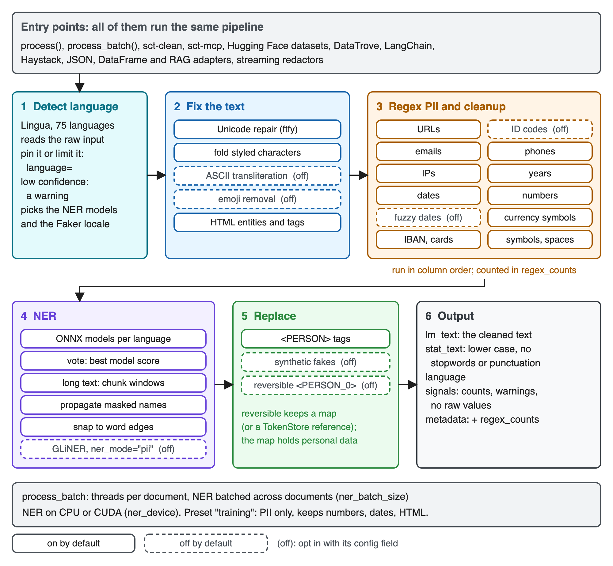

# SqueakyCleanText

[](https://pypi.org/project/squeakycleantext/)
[](https://github.com/rhnfzl/SqueakyCleanText/actions/workflows/python-package.yml)
[](https://pypi.org/project/squeakycleantext/)
[](https://github.com/rhnfzl/SqueakyCleanText/blob/main/LICENSE)

Real-world text is messy: broken encoding, HTML, URLs, and personal data such as names, emails and phone numbers. SqueakyCleanText cleans that text and replaces the personal data with tags, fake values or reversible placeholders, in one call and in 75 languages. It is for teams that feed text into LLMs, training sets, search indexes or classic ML models and need it clean and safe to share first.

It finds most personal data, not all of it. Check its output before you publish sensitive data.

Documentation: <https://rhnfzl.github.io/SqueakyCleanText/>

## Before and after

```python
from sct import TextCleaner

text = "<p>Hi, I’m John Smith. Mail me at john.smith@example.com or call +31 6 1234 5678.</p>"
print(TextCleaner().process(text).lm_text)
# -> <HTML>Hi, I'm <PERSON>. Mail me at <EMAIL> or call <PHONE>.<HTML>
```

The broken `’` is repaired to an apostrophe, the HTML tags become `<HTML>` (set `replace_with_html=""` to drop them), and the name, email and phone become tags.

## Use SCT when

- You send user text (tickets, chats, emails, scraped pages) to an LLM, a RAG index or a training set and must take the personal data out first.
- Your text comes in many languages and scripts, and you want one tool for all of them.
- You need the original values back later: reversible placeholders keep a map you store apart.
- You want to log or report what was found without logging the values (value-free `signals`).
- Do not use it alone for tables with known PII columns: drop or hash those columns, or use a tool built for structured data such as Presidio structured.

## Install

```sh
pip install squeakycleantext
```

Python 3.12 or newer. The base install runs NER with ONNX Runtime; it needs no PyTorch. The extras you are most likely to need:

| Extra | Why you need it |
|---|---|
| `gpu` | Run NER on an NVIDIA GPU (CUDA ONNX Runtime) |
| `synthetic` | Replace PII with fake values (Faker) |
| `gliner` | Zero-shot NER with your own labels, and `ner_mode="pii"` (58 PII labels) |
| `datasets`, `datatrove` | Clean Hugging Face datasets or DataTrove pipelines |
| `mcp` | Run SCT as an MCP server for AI assistants |

Install with `pip install "squeakycleantext[gpu,synthetic]"`. All extras: [docs/INSTALL.md](https://github.com/rhnfzl/SqueakyCleanText/blob/main/docs/INSTALL.md).

<!-- --8<-- [start:quickstart] -->
## Quickstart

```python
from sct import TextCleaner

cleaner = TextCleaner()
result = cleaner.process("Contact John Doe at john.doe@company.com. Meeting on 2023-10-01.")
print(result.lm_text)    # -> Contact <PERSON> at <EMAIL>. Meeting on <DATE>.
print(result.stat_text)  # -> contact person email meeting date
print(result.language)   # -> ENGLISH
```

`lm_text` keeps the sentence for LLMs. `stat_text` is lower-cased, without stopwords and punctuation, for classic ML models. The result also unpacks as `lm_text, stat_text, language`.

Clean many texts at once with `process_batch`. It runs documents in threads and batches the NER calls across them:

```python
from sct import TextCleaner

cleaner = TextCleaner()
for r in cleaner.process_batch(["Mail jan@example.nl", "Bel +31 20 123 4567 voor Jan de Vries."]):
    print(r.language, r.lm_text)
# -> ENGLISH Mail <EMAIL>
# -> DUTCH Bel <PHONE> voor <PERSON>.
```

For more PII types (IDs, bank numbers, health data and more), use the GLiNER PII model with `TextCleaner(cfg=TextCleanerConfig(ner_mode="pii"))`. It needs the `gliner` extra.
<!-- --8<-- [end:quickstart] -->

## How it works

1. **Detect language.** Lingua reads the raw input and picks one of 75 languages. Pin it with `language="de"` or limit it with `language=("en", "nl")`.
2. **Fix the text.** ftfy repairs broken unicode and HTML entities, styled characters such as `𝐣𝐨𝐡𝐧` are folded, and HTML tags are replaced. Emoji removal and ASCII folding are off by default.
3. **Regex PII.** URLs, emails, IPs, dates, phones, years and numbers become tags. Currency symbols become ISO codes by default (`€100` becomes `EUR<NUMBER>`); set `replace_with_currency_symbols="<CURRENCY>"` to get a tag. Then isolated letters and symbols, bracket content and extra whitespace are cleaned up. Each type is counted.
4. **NER.** By default an ensemble of ONNX models per language finds persons, locations, organisations and misc entities. Long texts are cut into chunk windows (no overlap unless you set `ner_chunk_overlap`). You can switch to PyTorch, GLiNER or the GLiNER PII mode, and apply a privacy policy.
5. **Replace.** Found values become `<TAG>`s (default), fake values (`synthetic`) or indexed placeholders such as `<PERSON_0>` with a map to restore them (`reversible`).
6. **Output.** `lm_text`, `stat_text` and `language`, plus `metadata` and `signals`. `signals` holds counts, warnings and model ids, never raw values. `metadata` holds the same counts, and it can hold raw values: the reversible map (`anon_map`, unless you pass a `TokenStore`) and `findings` with entity text (with `include_entities=True` or a privacy policy).

<picture>
  
</picture>

<details>
<summary>The diagram as text</summary>

- Entry points: `process()`, `process_batch()`, the `sct-clean` CLI, the `sct-mcp` server, the Hugging Face `datasets`, DataTrove, LangChain and Haystack adapters, the JSON, DataFrame and RAG adapters, and the streaming redactors. All of them pass text to the same pipeline.
- 1 Detect language (Lingua, 75 languages, on the raw input) -> 2 Fix the text -> 3 Regex PII (counted in `regex_counts`) -> 4 NER (chunk windows for long text, overlap only with `ner_chunk_overlap`) -> 5 Replace (`<TAG>`, synthetic fakes, or reversible `<PERSON_0>` with a map in `metadata` or a `TokenStore`) -> 6 Output (`lm_text`, `stat_text`, `language`) and `metadata` / `signals` (`signals` has no raw values; `metadata` can hold the reversible map and `findings`).
- Across all stages: `process_batch` runs documents in threads and batches NER across them (`ner_batch_size`); NER runs on CPU or CUDA (`ner_device`); the `training` preset turns stages on and off.

</details>

Every step is a `TextCleanerConfig` field with a safe default. The source of the diagram is [resources/sct_flow.excalidraw](https://github.com/rhnfzl/SqueakyCleanText/blob/main/resources/sct_flow.excalidraw).

## What you get back

`process` returns a `ProcessResult` with `lm_text`, `stat_text`, `language` and `metadata`:

```python
from sct import TextCleaner

result = TextCleaner().process("Mail jan@example.nl or call +31 20 123 4567.")
print(result.metadata["regex_counts"])
# -> {'EMAIL': {'count': 1, 'chars': 14}, 'PHONE': {'count': 1, 'chars': 15}}
print(result.signals["pii_count"], result.signals["pii_types"], result.signals["sensitive"])
# -> 2 {'EMAIL': 1, 'PHONE': 1} True
```

- `metadata` always holds `regex_counts`, `entity_counts`, `language_confidence`, `language_source`, `warnings` (such as `language_low_confidence` or `ner_fallback_models`) and `provenance` (the NER models and revisions that ran).
- `signals` is the value-free view of the same data, with the same keys for every input. It is safe to log or store next to the cleaned text.
- Entity text appears only when you ask for it (`include_entities=True` or a privacy policy adds `metadata["findings"]`) and in the reversible map. Keep those out of logs. Full field list: [docs/API.md](https://github.com/rhnfzl/SqueakyCleanText/blob/main/docs/API.md).

## Common recipes

**Training or RAG data.** The `training` preset only takes out PII and repairs unicode. Numbers, dates, HTML, case, line breaks and code stay as written:

```python
from sct import TextCleaner, preset_config

cleaner = TextCleaner(cfg=preset_config("training"))
print(cleaner.process("Order 4711 from <b>Anna Berg</b> (anna@example.se) on 2024-05-01.").lm_text)
# -> Order 4711 from <b><PERSON></b> (<EMAIL>) on 2024-05-01.
```

**Reversible placeholders.** Keep the map in a `TokenStore` and restore the values later ([docs/REPLACEMENT_MODES.md](https://github.com/rhnfzl/SqueakyCleanText/blob/main/docs/REPLACEMENT_MODES.md), [docs/PRIVACY.md](https://github.com/rhnfzl/SqueakyCleanText/blob/main/docs/PRIVACY.md)). `replacement_mode="synthetic"` (`synthetic` extra) puts fake values in place instead. The same document always gets the same fakes.

```python
from sct import InMemoryTokenStore, TextCleaner, TextCleanerConfig

store = InMemoryTokenStore()
cleaner = TextCleaner(cfg=TextCleanerConfig(replacement_mode="reversible"), token_store=store)
result = cleaner.process("Maria lives in Utrecht.")
print(result.lm_text)  # -> <PERSON_0> lives in <LOCATION_0>.
print(store.load(result.metadata["anon_map_reference"]).deanonymize(result.lm_text))  # -> Maria lives in Utrecht.
```

**Privacy policy.** Decide per entity type what to keep or redact, and get a versioned audit trail ([docs/PRIVACY.md](https://github.com/rhnfzl/SqueakyCleanText/blob/main/docs/PRIVACY.md)):

```python
from sct import EntityRule, PrivacyPolicy, TextCleaner

policy = PrivacyPolicy(name="support-export", version="1", rules={
    "PERSON": EntityRule(action="redact", min_score=0.8),
    "ORGANISATION": EntityRule(action="keep"),
})
print(TextCleaner(privacy_policy=policy).process("Maria Chen from Acme Corp wrote to us.").lm_text)
# -> <REDACTED> from Acme Corp wrote to us.
```

**GPU.** Install the `gpu` extra and set `TextCleanerConfig(ner_device="cuda", cuda_device_id=0)`. If CUDA cannot load, NER runs on CPU and each result gets the `cuda_fallback` warning ([docs/PERFORMANCE.md](https://github.com/rhnfzl/SqueakyCleanText/blob/main/docs/PERFORMANCE.md)).

**Your own entity labels.** With the `gliner` extra, set `ner_backend="gliner"`, `gliner_model="urchade/gliner_multi-v2.1"` and `gliner_labels=("person", "product", "event")`; unmapped labels become tags such as `<PRODUCT>` ([docs/NER_BACKENDS.md](https://github.com/rhnfzl/SqueakyCleanText/blob/main/docs/NER_BACKENDS.md)).

## Use it in your stack

| Integration | Usage | Extra | Docs |
|---|---|---|---|
| Hugging Face `datasets` | `clean_dataset(ds, columns=["text"], num_proc=4)` | `datasets` | [INTEGRATIONS](https://github.com/rhnfzl/SqueakyCleanText/blob/main/docs/INTEGRATIONS.md) |
| DataTrove | `SCTCleaner()` as a pipeline step | `datatrove` | [INTEGRATIONS](https://github.com/rhnfzl/SqueakyCleanText/blob/main/docs/INTEGRATIONS.md) |
| LangChain | `SCTDocumentTransformer().transform_documents(docs)` | `langchain` | [INTEGRATIONS](https://github.com/rhnfzl/SqueakyCleanText/blob/main/docs/INTEGRATIONS.md) |
| Haystack | `pipe.add_component("sct", SCTDocumentCleaner())` | `haystack` | [INTEGRATIONS](https://github.com/rhnfzl/SqueakyCleanText/blob/main/docs/INTEGRATIONS.md) |
| JSON, DataFrame, RAG chunks | `process_json(cleaner, value)` | none | [ADAPTERS](https://github.com/rhnfzl/SqueakyCleanText/blob/main/docs/ADAPTERS.md) |
| Streams | `WindowedStreamingRedactor(cleaner)` | none | [ADAPTERS](https://github.com/rhnfzl/SqueakyCleanText/blob/main/docs/ADAPTERS.md) |
| Ray, Spark, Polars, DuckDB, dlt, Daft | `clean_columns(handle, batch)` | none | [RECIPES](https://github.com/rhnfzl/SqueakyCleanText/blob/main/docs/RECIPES.md) |
| Command line | `printf 'Email maria@example.com' \| sct-clean` | none | [ADAPTERS](https://github.com/rhnfzl/SqueakyCleanText/blob/main/docs/ADAPTERS.md) |
| MCP server | `sct-mcp` | `mcp` | [MCP](https://github.com/rhnfzl/SqueakyCleanText/blob/main/docs/MCP.md) |

The framework adapters use the `training` preset unless you pass a config, build one cleaner per worker process, and reject reversible mode.

## Performance

Default config (full multilingual NER ensemble), release benchmark documents, SCT 0.8.0, AMD Ryzen Threadripper PRO 7985WX and RTX 4090, median of 3 runs:

| Workload | Hardware | Docs/s |
|---|---|---|
| `process`, one document at a time | 16 CPU cores | 5.0 |
| `process_batch`, short documents, 16 workers | 16 CPU cores | 15.5 (0.7.1: 3.7) |
| `process_batch`, short documents, 16 workers | 64 CPU cores | 29.2 |
| `process_batch`, short documents, English only (2 models) | RTX 4090 | 646 |

Source and method: [docs/PERFORMANCE.md](https://github.com/rhnfzl/SqueakyCleanText/blob/main/docs/PERFORMANCE.md) and [evaluation/results/comparison-0.7.1-0.8.0.md](https://github.com/rhnfzl/SqueakyCleanText/blob/main/evaluation/results/comparison-0.7.1-0.8.0.md). Measure your own machine with `python -m scripts.benchmark_release --batch 256 --batch-size 8 --ner-batch-size 8`.

## Quality and evaluation

- Open-dataset benchmark (12 PII datasets, about 30 languages, long documents, language ID, cleaning, speed): [benchmarks/](https://github.com/rhnfzl/SqueakyCleanText/tree/main/benchmarks), scores per release in `benchmarks/results/`.
- Release benchmark (30 documents, 84 entities, 9 languages): exact-span F1 0.99 and 0 of 67 PII values leaked in 0.8.0. Run `python -m scripts.benchmark_release`.
- Multilingual PII eval (220 synthetic records, 11 languages): the default ensemble scores 0.93 recall and 0.95 precision. Run `python -m scripts.run_multilingual_eval` ([docs/MULTILINGUAL_EVAL.md](https://github.com/rhnfzl/SqueakyCleanText/blob/main/docs/MULTILINGUAL_EVAL.md)).
- Score columns and data cards: `sct-report data.jsonl --text-column text --out report.json` writes counts, shares and hashes, never text ([docs/SCORE.md](https://github.com/rhnfzl/SqueakyCleanText/blob/main/docs/SCORE.md)).
- Test your own model or data with the PII evaluation harness ([docs/EVALUATION.md](https://github.com/rhnfzl/SqueakyCleanText/blob/main/docs/EVALUATION.md)).

## Languages

Language detection covers 75 languages. Full NER models cover 4 (English, Dutch, German, Spanish). The rest use the multilingual WikiNEural model with the English model, or a model you bring with `ner_models`. Full list: [docs/LANGUAGES.md](https://github.com/rhnfzl/SqueakyCleanText/blob/main/docs/LANGUAGES.md).

## Limits and design principles

- **Safe defaults, every choice configurable.** Each behaviour is a config field; nothing is forced.
- **No guarantee that all PII is found.** Models miss entities, mostly organisations and non-Latin scripts. Review output before you publish it.
- **Reversible maps are personal data.** Anyone with the map can restore the values. Store maps apart from the cleaned data, with access control.
- **Offsets are post-regex.** Finding offsets point into the text after the regex step, not into the raw input.
- **Synthetic data is not anonymisation.** Fake values keep the data useful; they do not make it anonymous in a legal sense.

<details>
<summary>Known limits of 0.8.1 (details in <a href="CHANGELOG.md">CHANGELOG.md</a>)</summary>

- Dates: only full dates become one `<DATE>`. `1990年1月`, `1月15日`, Japanese era years and `1990.1.15.` do not; the year and number steps still change them (`1990年1月` becomes `<YEAR>年<NUMBER>月`, `生日1990.1.15谢谢` becomes `<YEAR><NUMBER>.15`). A circled number glued to a unit character (`1月⑮日`) stays a list marker. Thai month names need `custom_month_names`.
- In ensembles with GLiNER, windows are sized for the token-classification models, not for GLiNER's own word limit. GLiNER2 runs one chunk per call; torch models and GLiNER keep one lock per model, so they do not run in parallel across threads.
- Only `process_batch` is faster; `process` of one document is not batched across documents.
- `ner_chunk_overlap` (off by default) can still cut an entity longer than the overlap that starts at the very end of a chunk.
- `06-12345678` becomes `06-<PHONE>`. Adversarial strings such as `+000000000(000)0` can leave `(000)0` after phone replacement.
- Two addresses glued with no separator in a script written without spaces can be read as one address or split at the wrong place.
- ORGANISATION is the weakest NER label (0.75 recall in the multilingual eval); Bengali and Tamil name spans can be a few characters off.
- A URL path that switches from Latin letters or digits straight into a script written without spaces is replaced only up to the switch (`https://x.org/a東京secret` becomes `<URL>東京secret`). Rare styled URL hosts and mail addresses (`https://ab｡⑧․cd.ex.com/...`, `INFO@COL·LEGI。CAT`) are not fully replaced.
- Score B's quality head was tested with a small ONNX graph only; GLiNER PII mode was not run end to end for this release. CI does not install the `mcp` extra; FastMCP-only tests skip there.
- An unpinned NER model makes one Hub request per worker when the parent never loaded it before forking; pin `ner_model_revisions` or set `HF_HUB_OFFLINE=1`.
- With an empty regex marker (`replace_with_email=""`), NER in synthetic or reversible mode can find other entities than in placeholder mode.
- `WindowedStreamingRedactor` can cut an HTML tag that holds a space when the tag reaches past `overlap_chars`. It raises `BufferError` when the buffer passes `max_buffer_chars` (default 4096) with no safe whitespace split; raise the limit or use `BufferedStreamingRedactor`.

</details>

## Documentation

| Topic | Where |
|---|---|
| Install and all extras, speed and hardware | [docs/INSTALL.md](https://github.com/rhnfzl/SqueakyCleanText/blob/main/docs/INSTALL.md), [docs/PERFORMANCE.md](https://github.com/rhnfzl/SqueakyCleanText/blob/main/docs/PERFORMANCE.md) |
| Every config field, presets, language options | [docs/CONFIG.md](https://github.com/rhnfzl/SqueakyCleanText/blob/main/docs/CONFIG.md) |
| `TextCleaner`, `ProcessResult`, `signals` | [docs/API.md](https://github.com/rhnfzl/SqueakyCleanText/blob/main/docs/API.md) |
| NER backends, default models, GLiNER, PII mode | [docs/NER_BACKENDS.md](https://github.com/rhnfzl/SqueakyCleanText/blob/main/docs/NER_BACKENDS.md) |
| Synthetic and reversible replacement, GLiClass | [docs/REPLACEMENT_MODES.md](https://github.com/rhnfzl/SqueakyCleanText/blob/main/docs/REPLACEMENT_MODES.md) |
| Privacy policies, `TokenStore`, offsets, k-anonymity | [docs/PRIVACY.md](https://github.com/rhnfzl/SqueakyCleanText/blob/main/docs/PRIVACY.md) |
| JSON, DataFrame, RAG, CLI, streaming, OCR, browser | [docs/ADAPTERS.md](https://github.com/rhnfzl/SqueakyCleanText/blob/main/docs/ADAPTERS.md) |
| Framework adapters, other engines, MCP server | [docs/INTEGRATIONS.md](https://github.com/rhnfzl/SqueakyCleanText/blob/main/docs/INTEGRATIONS.md), [docs/RECIPES.md](https://github.com/rhnfzl/SqueakyCleanText/blob/main/docs/RECIPES.md), [docs/MCP.md](https://github.com/rhnfzl/SqueakyCleanText/blob/main/docs/MCP.md) |
| Evaluation, score columns, `sct-report` | [docs/EVALUATION.md](https://github.com/rhnfzl/SqueakyCleanText/blob/main/docs/EVALUATION.md), [docs/SCORE.md](https://github.com/rhnfzl/SqueakyCleanText/blob/main/docs/SCORE.md), [docs/MULTILINGUAL_EVAL.md](https://github.com/rhnfzl/SqueakyCleanText/blob/main/docs/MULTILINGUAL_EVAL.md) |
| Languages and adding a language | [docs/LANGUAGES.md](https://github.com/rhnfzl/SqueakyCleanText/blob/main/docs/LANGUAGES.md), [docs/ADDING_LANGUAGES.md](https://github.com/rhnfzl/SqueakyCleanText/blob/main/docs/ADDING_LANGUAGES.md) |
| The whole API in one file, for AI coding assistants | [llms.txt](https://github.com/rhnfzl/SqueakyCleanText/blob/main/llms.txt) |

## What's new in 0.8.1

Fixes from the open-dataset benchmark ([benchmarks/](https://github.com/rhnfzl/SqueakyCleanText/tree/main/benchmarks)). Leak falls on all 12 PII datasets (REDACT 18.1% to 8.2%, long documents 42.4% to 11.7%); speed is unchanged.

- NER keeps a span when its best model passes the cut; other copies of a masked name are masked too.
- IBAN and card numbers get their own types; JSON and longer bracketed text survive cleanup.
- `Month/YY` dates, `Name <email>`, URLs before a full stop, and span edges inside words are fixed.

## What's new in 0.8.0

See [CHANGELOG.md](https://github.com/rhnfzl/SqueakyCleanText/blob/main/CHANGELOG.md) (many breaking changes). Highlights of 0.8.0:

- `process_batch` is 4.2x faster on short documents on 16 CPU cores; GPU device options.
- Detection of all 75 Lingua languages, with confidence and warnings.
- `result.signals`, a value-free view for logs, score columns and data cards (`sct-report`).
- Adapters for Hugging Face `datasets`, DataTrove, LangChain and Haystack, and a `training` preset.
- A reworked MCP server and a multilingual PII eval in 11 languages. Python 3.12 or newer.

## Related work

- [clean-text](https://github.com/jfilter/clean-text) normalises text and replaces URLs, emails and phones with rules. SCT adds NER for names and places and works in many languages.
- [ftfy](https://github.com/rspeer/python-ftfy) repairs broken unicode. SCT uses it as its first fix step.
- [Presidio](https://github.com/microsoft/presidio) is a PII detection and anonymisation framework you assemble from recognisers. SCT is one call with multilingual defaults and also cleans the text.
- [scrubadub](https://github.com/LeapBeyond/scrubadub) removes PII from free text with detectors. SCT adds text cleaning, reversible maps and value-free metadata.

## Contributing

Issues and pull requests are welcome. Read [AGENTS.md](https://github.com/rhnfzl/SqueakyCleanText/blob/main/AGENTS.md) first: model mistakes are fixed with model-driven rules, never with word lists, and every behaviour stays configurable.

## Citation

```bibtex
@software{fazal_squeakycleantext,
  author = {Fazal, Rehan},
  title = {SqueakyCleanText},
  url = {https://github.com/rhnfzl/SqueakyCleanText},
  version = {0.8.1},
  year = {2026}
}
```

## License and acknowledgements

MIT. See [LICENSE](https://github.com/rhnfzl/SqueakyCleanText/blob/main/LICENSE). The package took inspiration from [clean-text](https://github.com/jfilter/clean-text). It builds on [ftfy](https://github.com/rspeer/python-ftfy), [Lingua](https://github.com/pemistahl/lingua-py), [ONNX Runtime](https://onnxruntime.ai/) and the NER models listed in [docs/NER_BACKENDS.md](https://github.com/rhnfzl/SqueakyCleanText/blob/main/docs/NER_BACKENDS.md).
