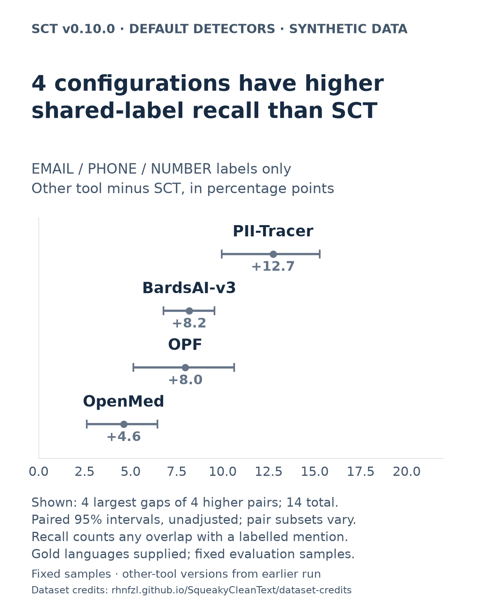
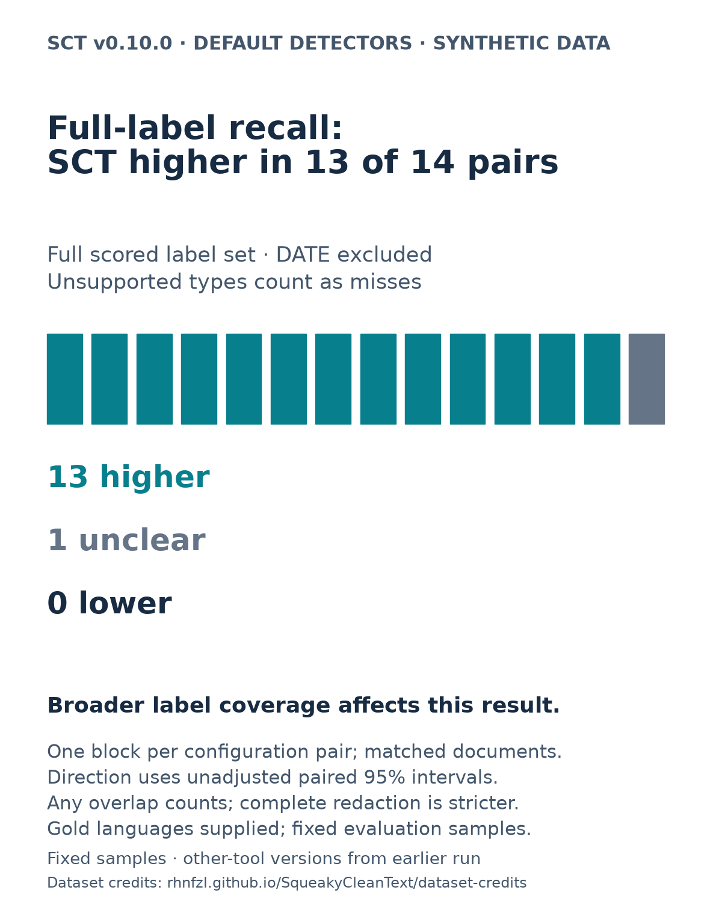
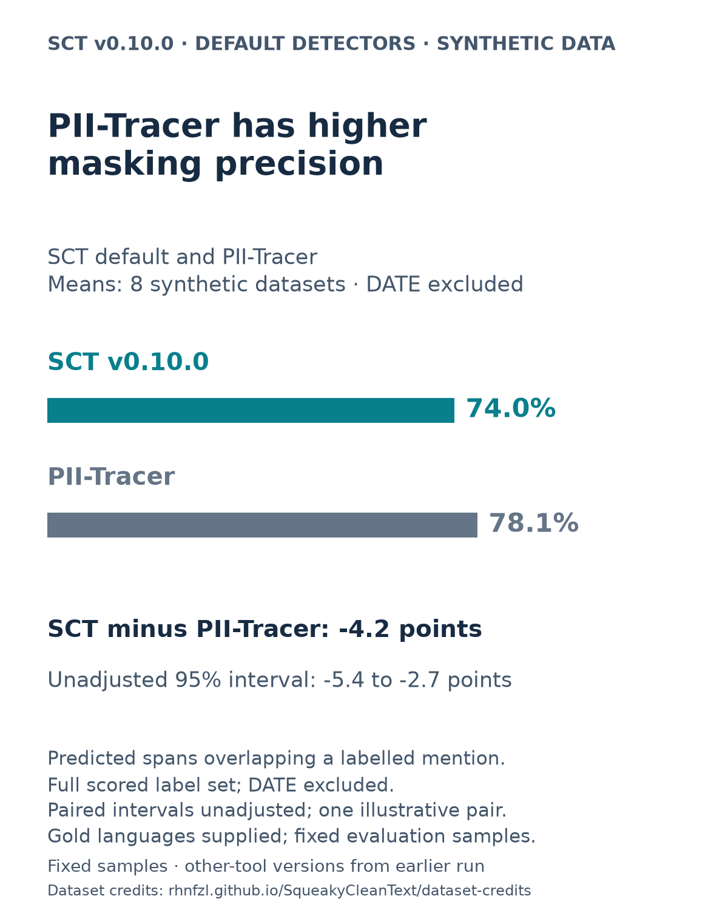
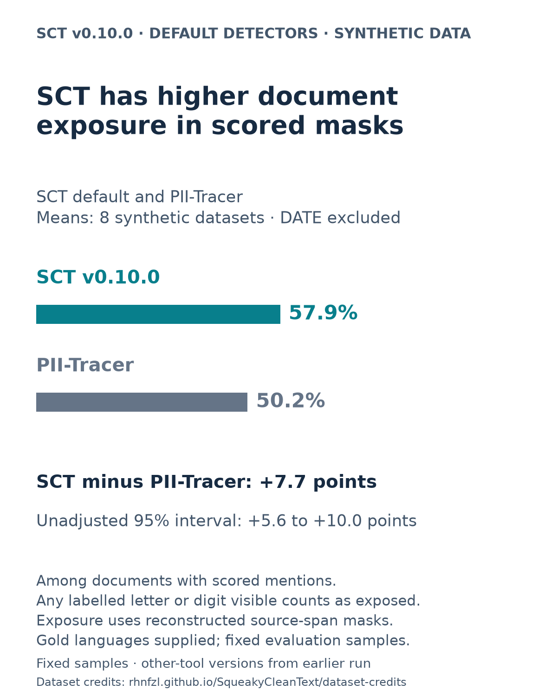
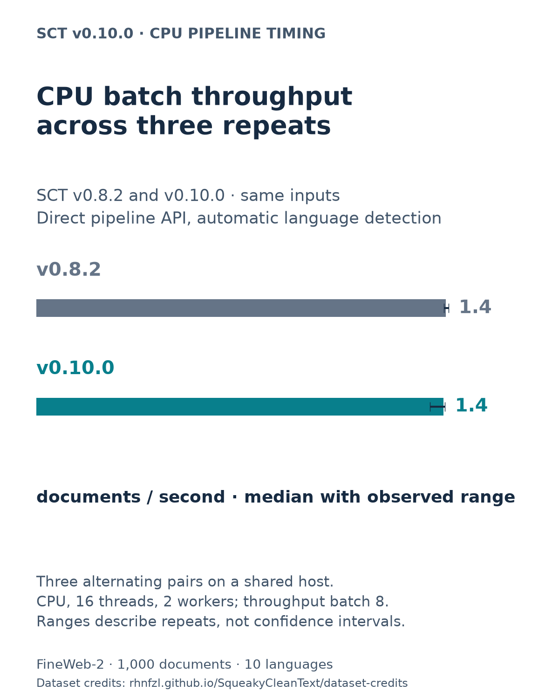
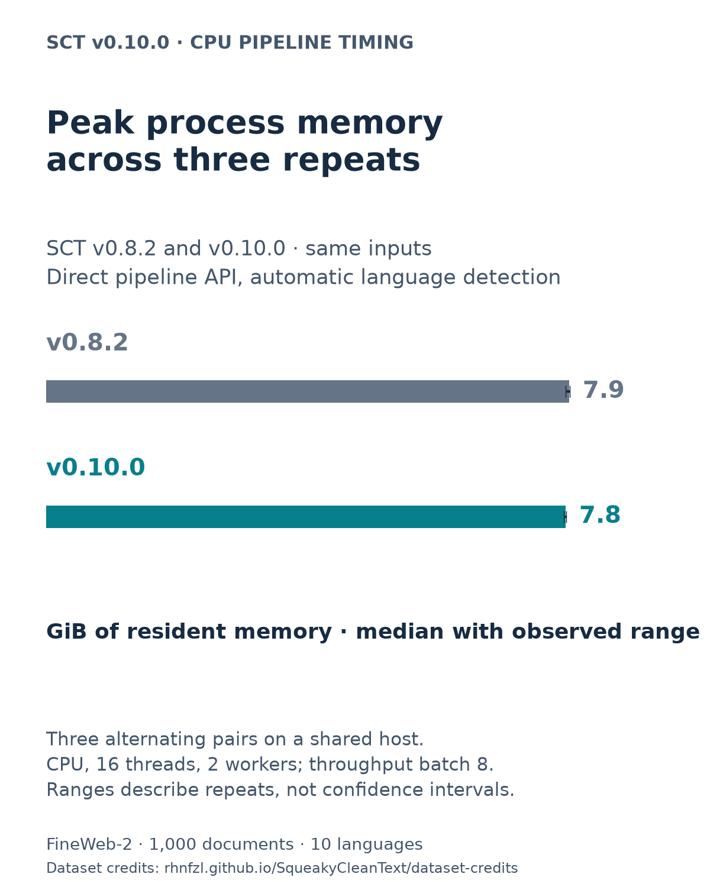

# SCT v0.10.0: PII comparisons and CPU measurements

This benchmark helps you compare SCT's default personal-data handling with fourteen pinned tool configurations.
Shared-label recall and full-label recall answer different questions because detector coverage differs.
The full processing pipeline and optional routing configurations are outside this comparison.

Fresh SCT inference covers 20,817 documents across twelve fixed datasets.
The other tools retain their historical package and model pins; this is not a comparison of every tool's latest release.
These samples were seen in earlier evaluation. No settings were tuned on this run, and this is not a newly held-out test.

## Findings

| View | SCT higher | Other configuration higher | Unclear |
| --- | ---: | ---: | ---: |
| Shared EMAIL, PHONE and NUMBER recall | 8 | 4 | 2 |
| Full scored label-set recall | 13 | 0 | 1 |

Higher means the paired 95% interval excludes zero. Intervals are not adjusted for multiple comparisons.
Pair subsets differ: each pair uses matched documents and languages on datasets marked clean for both configurations.
DATE is excluded. Unsupported types count as misses in the full-label view, so broader label coverage affects that result.





## Precision and visible labelled text

For the SCT / PII-Tracer pair across eight synthetic datasets, masking precision is 73.96% versus 78.12%.
Document exposure is 57.90% versus 50.17%. Lower exposure is preferable.

Recall credits any overlap with a labelled mention. That can include a partial mask.
Exposure counts documents with any labelled letter or digit still visible in reconstructed source-span masks.
Its denominator is documents containing scored mentions. It does not measure the amount of visible text or certify anonymity.
Reconstructed-mask exposure is separate from inspection of the native transformed output.





## CPU measurements

The direct pipeline API uses the same 1,000 FineWeb-2 documents across ten languages, automatic language detection,
sixteen ONNX Runtime threads, two workers, and three alternating fresh-process trials per version.
Throughput uses batches of eight. Latency uses single documents after twenty warm-up documents.
Dependencies and model revisions match between versions.

| Measure | SCT v0.8.2 median [min, max] | SCT v0.10.0 median [min, max] |
| --- | ---: | ---: |
| Throughput, documents/second | 1.402 [1.396, 1.411] | 1.394 [1.347, 1.398] |
| Single-document median latency, ms | 612.18 [604.21, 624.95] | 601.51 [573.44, 610.75] |
| Single-document p95 latency, ms | 2047.97 [1971.95, 2076.67] | 1994.22 [1992.13, 2017.91] |
| Peak process resident memory, MiB | 8042.7 [7991.0, 8053.8] | 7994.6 [7961.1, 8000.7] |

Throughput is similar. These measurements do not support a speedup headline.
Ranges describe three observed repeats on a shared host, not confidence intervals or an isolated code-only speed effect.
Memory includes the models and language detector. The chart uses GiB; the table retains MiB.





## Method and limits

Quality inference uses SCT v0.10.0 default detectors, supplied gold languages, and reversible scoring output.
It samples up to 300 records per language with seed 13 and inference batch size one.
Metrics average across languages within each dataset, then across datasets.
Intervals use 1,000 paired group-bootstrap resamples.
The social charts use eight synthetic datasets; three real-data datasets and one untyped legal dataset remain separate.

All SCT cells complete without inference failures. Other-tool cells retain 29 failed documents across six cells.
Failed documents count as unmasked. See the [validation manifest](default/validation.json) for the breakdown.
Validated cache reuse saves 154 other-tool inference cells. NUS-LT inference runs fresh and its predictions are deleted after scoring.

RedactionBench has 134 unplaced SCT spans, versus 39 in the archived v0.8.2 run.
The largest increases reproduce cached output and do not show the tested glued-quote normalization mismatch.
Other cases are not exhaustively diagnosed. This is a source-position reconstruction limit, not a standalone detection-accuracy score.
That untyped legal group is outside the eight synthetic datasets used in these charts.

Only aggregates are published. Raw text and predictions remain outside the repository.
Per-dataset result files retain source credits, licence notes, model identities and exact pair configuration metadata.

## Evidence and regeneration

- [Protocol and reproduction notes](default/README.md)
- [All aggregate comparisons](default/summary.json)
- [All six native timing trials](default/native-speed.json)
- [Validation checks and 180 result-file hashes](default/validation.json)
- [Runtime versions, model revisions and source hashes](default/provenance.json)
- [Exact chart values and image descriptions](visuals/manifest.json)

Run from the repository root in an environment with Python 3.12+, Matplotlib 3.11.2 and Pillow 13.0.0:

```sh
python -m scripts.plot_pii_social_release \
  benchmarks/results/compare-2026-11-12-v010/default \
  /tmp/sct-v010-charts
```

The script checks the recorded version and summary/timing hashes before drawing.
Each chart has PNG, editable SVG, phone and grayscale exports in [visuals/](visuals/).
The chart design follows [Karthik's visualization guidance](https://github.com/skthewimp/karthik-data-visualization-skill).

**Dataset credits.** Scores here use DialogPII, KDPII, EuroPII, Greek DeID, MedDeID, NeonRedact-TR, newmean, pl-pii-bench, RedactionBench, Tonic PrivacyBench, FineWeb2. These datasets are under CC BY or other attribution licences. Creators, sources, licences and citations are in [benchmarks/DATASET_CREDITS.md](https://github.com/rhnfzl/SqueakyCleanText/blob/main/benchmarks/DATASET_CREDITS.md).
